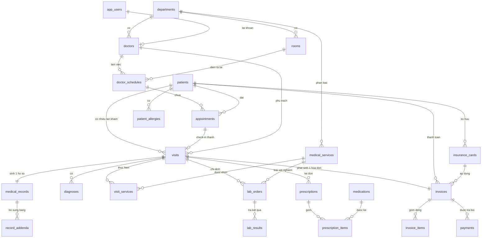

# ERD — MediCore Hospital Database

> Sơ đồ quan hệ thực thể của cơ sở dữ liệu `MediCoreDB` (24 bảng). Vẽ bằng Mermaid — mở được trên GitHub/VS Code, hoặc dán vào draw.io/mermaid.live để xuất ảnh.

## Giải thích các mối quan hệ chính

| Quan hệ | Ý nghĩa nghiệp vụ |
|---|---|
| `patients` 1—N `visits` | Một bệnh nhân có nhiều lần khám nhưng chỉ có **một hồ sơ định danh** (CCCD duy nhất). Đây là điểm khác biệt với cách làm "mỗi lần khám tạo 1 bệnh nhân mới". |
| `visits` 1—1 `medical_records` | Mỗi lần khám sinh đúng một hồ sơ bệnh án; hồ sơ có vòng đời DRAFT → LOCKED. |
| `medical_records` 1—N `record_addenda` | Sau khi khóa, mọi bổ sung đi qua phụ lục có duyệt — bản gốc không bao giờ bị sửa. |
| `doctor_schedules` 1—N `appointments` | Slot được quản lý ở cấp ca khám (sức chứa), không phải từng phút; `booked_count` do trigger đồng bộ. |
| `lab_orders` thuộc đúng 1 `visits` | Chỉ định xét nghiệm không tồn tại độc lập — luôn truy được về lần khám và bác sĩ chỉ định. |
| `lab_orders` 1—N `lab_results` | Một chỉ định (vd CBC) trả nhiều thông số; mỗi thông số có khoảng tham chiếu riêng để đánh cờ bất thường. |
| `visits` 1—1 `invoices`, `invoices` 1—N `invoice_items` | Hóa đơn tổng hợp từ 3 nguồn (dịch vụ / xét nghiệm / thuốc) qua các dòng có `source_id` truy xuất ngược được. |
| `invoices` 1—N `payments` | Thanh toán tách theo bên trả (PATIENT / INSURANCE) để đối soát công nợ BHYT riêng. |
| `audit_logs` (độc lập) | Bảng nhật ký do trigger ghi; cố ý không khóa FK tới bảng nghiệp vụ để log không bị chặn bởi ràng buộc và giữ được cả khi bản ghi gốc bị xóa. |

## Nhóm bảng theo phân hệ

- **Danh mục & tổ chức:** departments, rooms, doctors, app_users, medical_services, medications
- **Bệnh nhân:** patients, patient_allergies, insurance_cards
- **Khám bệnh:** doctor_schedules, appointments, visits, medical_records, record_addenda, diagnoses
- **Cận lâm sàng:** visit_services, lab_orders, lab_results
- **Dược:** prescriptions, prescription_items
- **Tài chính:** invoices, invoice_items, payments
- **Kiểm toán:** audit_logs
